<div align="center">




</div>

<br/>


<br/>


```json
{
  "nome": "Cauã Vitor",
  "local": "Minas Gerais, BR",
  "foco": "automação de processos com IA",
  "faculdade": "Ciência da Computação @ Univertix",
  "tcc": "IA e o mercado de TI no Brasil",
  "trilha": "Técnico em Redes · Cisco Networking Academy",
  "copiloto": "Claude Code",
  "mantra": "se é repetitivo, dá pra automatizar"
}
```

<br/>


<br/>


<br/>


<div align="center">

<a href="https://wa.me/5531983541634"></a>
&nbsp;
<a href="https://www.cauaravaiano.com.br"></a>
<br/>
<a href="https://www.linkedin.com/in/cauaravaianodev/"></a>
&nbsp;
<a href="mailto:cauaravaiano.15@gmail.com"></a>


</div>
