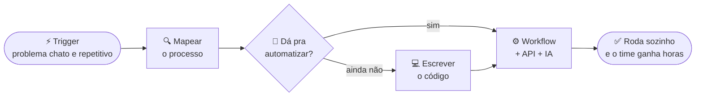

<div align="center">


</div>



## 🧾 `GET /sobre-mim`

```json
{
  "nome": "Cauã Vitor",
  "local": "Minas Gerais, BR",
  "papel": "Automação de CRM e marketing com IA",
  "clientes": "empresas de serviços nos EUA",
  "faculdade": "Ciência da Computação @ Univertix",
  "tcc": "IA e o mercado de TI no Brasil",
  "trilha": "Técnico em Redes · Cisco Networking Academy",
  "copiloto": "Claude Code",
  "hobbies": ["Godot", "Minecraft", "corrida de rua"]
}
```

## 🔀 Workflows em produção

| Nó | O que faz |
|---|---|
| ⚡ **Gatilhos** | Formulário do site, webhook, resposta de SMS, mudança de etapa no funil |
| 🤖 **IA no fluxo** | Classifica a intenção da resposta do lead e decide o próximo passo |
| 🔁 **Follow-up** | Sequências de SMS e e-mail, reativação de base e lembretes |
| 🧭 **Roteamento** | Rodízio de vendedores, dono do lead, SLA e passagem de card no pipeline |
| 📊 **Medição** | Origem do lead (UTM / orgânico) e dashboards de resultado |

## 🧩 Projetos

```diff
+ motor-ghl        Python · cria e publica workflows e dashboards no GoHighLevel via API, guiado por documento
+ painel-local     Python · central das subcontas: status, tarefas e verificações automáticas
+ sites-locais     Astro  · sites com SEO local que já entram direto no funil do CRM
+ ilha-perdida     Godot 4 · jogo mobile de fazenda e economia para Android
+ baymax           PWA    · assistente de saúde e bem-estar (Semana Acadêmica)
```

## 🛠️ Stack

<div align="center">


</div>

## 📈 Execuções

<div align="center">


</div>

---

<div align="center">

```bash
$ caua --contato
→ portfólio: https://www.cauaravaiano.com.br
→ se é repetitivo, dá pra automatizar. bora conversar.
```

<a href="https://www.cauaravaiano.com.br"></a>

</div>
